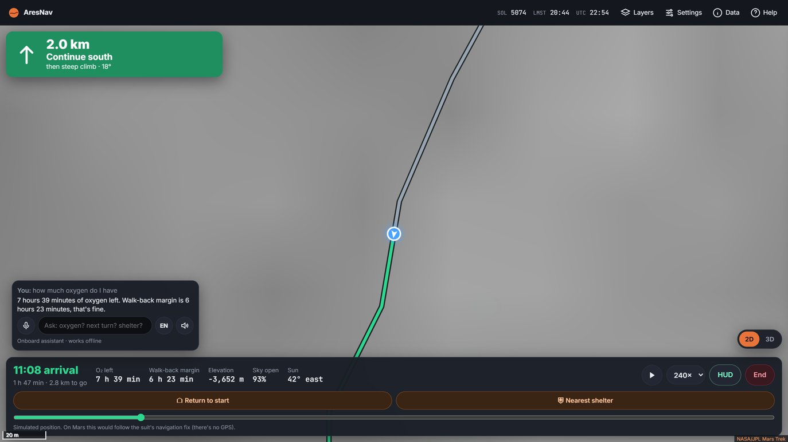
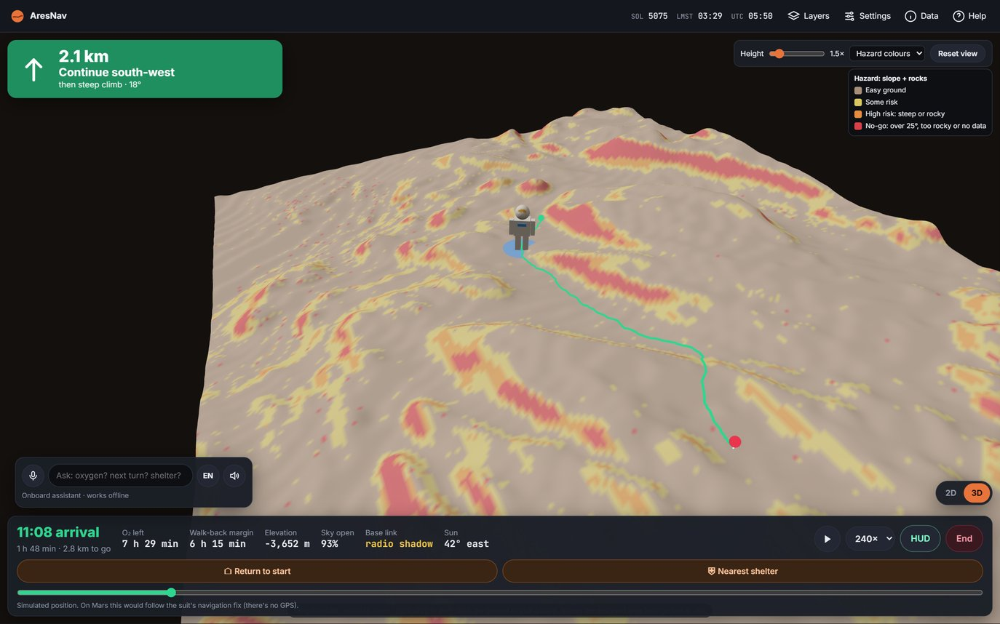

# Marswalk Navigator

**Live demo: [jungwoolee212.github.io/mars-eva-navigator](https://jungwoolee212.github.io/mars-eva-navigator/)**. It runs in the browser with nothing to install. Press *Try an example route*, then *Start*.


| Turn-by-turn guidance with the voice assistant | 3D view of the analysed terrain |
|---|---|
|  |  |

Screenshots are of the live app (not AI-generated).

**NASA Space Apps Challenge 2026.** A navigation app for crew on foot or in a pressurized rover on Mars. Pick a start and a destination; it plans the safest route and checks it for dangers, elevation, sunlight and radiation shielding. Then it guides you turn by turn on a map, in a helmet HUD or by voice (English or Korean).

It is built around lower Mount Sharp in Gale crater, where a prebuilt HiRISE terrain grid gives EVA-grade results. You can plan anywhere else on Mars too: the app uses the sharpest NASA Mars Trek elevation model for that ground, and routes planned only on coarse global terrain are flagged as a rough guide (small cliffs and rocks don't show at that scale), never "safe to go".

## How to use

1. **Tap the map** to set your start, then tap again for your destination. Or press *Try an example route*.
2. Read the result: travel time, distance, arrival time (Mars local time) and a safety status. Expand it to see every check.
3. **Report** lists each danger (steep climbs, rocky ground, no-go edges, terrain shadow) with its location on the map, plus elevation, sky-view shielding and sunlight.
4. **Checkpoints are optional.** Once a route exists, tap the map and choose *Add checkpoint here*, or use *+ Add checkpoint*. Name it, set how long you'll stop, drag it to move it.
5. Switch between **Crew on foot** and **Rover**. Each has its own slope, rock and speed limits (Settings).
6. **Start** begins turn-by-turn guidance on a simulated position. **HUD** opens the helmet display with a 3D view of the terrain ahead. Keys: Space pauses, H toggles the HUD, V talks to the voice assistant, Esc goes back.

## Where you can plan

Anywhere on Mars (88°S–88°N). Once start and destination are set, the app picks the sharpest elevation model NASA Mars Trek has for that ground and analyses a corridor around the route in the browser:

| Ground | Elevation used | What the result means |
|---|---|---|
| Prebuilt box, lower Mount Sharp (orange) | `data/` (HiRISE DEM) | EVA-grade |
| Regional models outlined on the map: Gale, Jezero, Columbia Hills, Endeavour, Victoria, InSight, Valles Marineris, Deuteronilus, Apollinaris… (`js/catalog.js`) | HiRISE ~1 m or CTX/HRSC ~20–50 m. Metres straight from Trek's elevation services where they exist; for models served only as 8-bit tiles, a metre scale fitted against the global MOLA + HRSC blend | EVA-grade on HiRISE; coarser on CTX/HRSC |
| Everywhere else | Global MOLA + HRSC blend, ~200 m/px | Rough guide only: the general way is right, but cliffs, ledges and rocks smaller than a few hundred metres don't show, so it is flagged in the safety checks and never called "safe to go" on foot |

**Places NASA Trek marks** (`js/places.js`, built by `tools/build_places.py`) are on the map and can be searched, spoken and used as start or destination: Trek's 12 mission bookmarks, 95 mission waypoints (e.g. Bradbury Landing, Vera Rubin Ridge, The Hab), 5 rover / story traverses, and all 1,783 IAU-named features. Click a point → *Start here* / *Make this the destination*, or search under Layers → Go to a site.

Rock density comes from HiRISE image texture where a HiRISE mosaic covers the ground; elsewhere it's marked "not assessed". Where the browser-built grid overlaps the prebuilt one, they agree closely (elevation MAE 1.5 m, slope MAE 2.6°, no-go agreement 96%).

**Refine.** The terrain line under the route summary shows the grid used. *Refine route terrain* (or Settings → Terrain detail → High) re-analyses the corridor between start and destination on a finer grid (down to 4 m), so long routes get coarser cells only where needed. `tools/build_catalog.py` rebuilds the catalog from Trek.

**2D / 3D.** The 2D/3D switch on the map shows the analysed terrain as a 3D mesh with the route, markers and (during guidance) your position. Drag to rotate, scroll to zoom, click the ground to pick a point. Colours show the hazard score; if the device renders slowly, it switches to a lighter gray mesh.

## Voice assistant

Tap the mic (or press **V**) and speak, or type in the box.

While planning:

- *"Route from the landing plain to the upper boxwork ridges"*, *"Start from 4.55 south 137.55 east"*, *"Take me to 2 km north west"*, *"Add a checkpoint 300 metres east of landing plain"*, *"Take me to the nearest shelter"*, *"Take me to the highest point"*, *"Switch to rover"*, *"Save the destination as Camp Two"*, *"Start navigation"*
- Places can be a name (built-in or saved), *start*, *destination*, *nearest shelter* (least open sky within 400 m), *highest/lowest point* (in the analysed area), a distance and direction (*"1 km south east of landing plain"*) or coordinates.

During guidance the navigator speaks each turn, steep section, checkpoint and safety alert as you reach it, and you can ask:

- *"How much oxygen do I have?"*, *"What's next?"*, *"How far to go?"*, *"Any danger ahead?"*, *"Where's the nearest shelter?"*, *"Is the sun up?"*, *"Next checkpoint?"*, *"Status"*
- Commands: *pause*, *resume*, *faster*, *slower*, *repeat*, *mute*, *open HUD*, *end navigation*
- Re-routing from where you are: *"Take me to the nearest shelter"*, *"Take me back to base"*, *"Take me to Camp Two"*

Answers come from the live route state onboard, with no network needed (a crew on Mars can't wait 5–20 minutes for Earth). Optionally, paste a Claude API key in **Settings → Voice assistant**: requests the onboard parser doesn't handle then go to Claude (`claude-opus-5-5`) with a snapshot of the app, and Claude can plan routes through a `set_route` tool that uses the same place resolver. Commands still run onboard. The key is kept only in that browser's localStorage and is sent only to the Anthropic API. If Claude can't be reached, the onboard answer is used.

**Korean (한국어).** Tap **EN/한** in the voice panel (or Settings → Voice language). Recognition switches to ko-KR, and replies and turn-by-turn prompts are spoken in Korean: *"착륙 평원에서 박스워크 능선까지 안내해 줘"*, *"가장 가까운 대피소로 데려가 줘"*, *"북서쪽으로 2킬로미터 가 줘"*, *"남위 4.55 동경 137.55에서 출발"*, *"산소 얼마나 남았어?"*, *"다음은 어디로 가?"*, *"일시정지"*, *"기지로 돌아가"*. `js/voice-ko.js` maps Korean phrasing onto the same commands and translates the assistant's sentences.

Speech output uses the browser's speech synthesis. Voice input uses the Web Speech API (Chrome, Edge, Safari); in other browsers, type the question.

## What it assesses

| Check | How |
|---|---|
| Route | A* over an 8 m grid. It minimises travel time plus a penalty near steep or rocky ground and never crosses no-go cells. |
| Slope & elevation | HiRISE Gale DEM (Mars Trek), slope over a ~70 m baseline |
| Rocks & ridges | Texture energy of the HiRISE mosaic |
| Oxygen / walk-back | Time out + time to walk back vs. suit duration minus reserve, at every point |
| Daylight & shadow | Sun position (Mars24 algorithm) vs. the terrain horizon at the time you pass each point |
| Radiation shielding | Share of the sky not blocked by terrain (sky-view factor from the DEM), plus the most sheltered spot near the route. Relative only: no dose data is used. |

## Data (NASA Mars Trek only)

- MRO HiRISE mosaic of Curiosity's roving site and the HiRISE Gale crater DEM: processed into `data/` by `tools/build_site_data.py`.
- Map layers: HiRISE, CTX, Viking, MOLA, THEMIS day/night IR, TES thermal inertia, clay/glass and plagioclase.
- Site context: NASA's *Curiosity's proposed path up Mount Sharp*.

**Elevation scale.** Trek serves the DEM as 8-bit tiles. Heights use `metres = 17.97 × DN − 4569.2`, fitted once against Curiosity's published elevations (RMS 4.6 m). This is disclosed in the app's Data panel. Slopes, shadows and shielding don't depend on it.

## Rebuild the terrain data

```bash
python3 tools/build_site_data.py
```

Needs `numpy` and `Pillow`. Downloads about 460 Trek tiles (about 6 minutes).

## Deploy (GitHub Pages)

Push to a public GitHub repo. Then go to **Settings → Pages → Deploy from a branch → `main` / root**. There is no build step.

## Use of AI (SI) tools

- **Code.** Most of the code, data-processing scripts and this README were written with an AI coding assistant, Claude Code (Anthropic's Claude models), under the team's direction. The team chose the design, set the requirements and data sources, and tested and reviewed the results.
- **Data.** No data in this app is AI-generated. Terrain, elevation, imagery and place names come from NASA Mars Trek. AI-written scripts in `tools/` process that data into `data/`, `js/catalog.js` and `js/places.js`.
- **In the app.** The voice assistant runs onboard without AI by default. If a user pastes their own Claude API key in Settings, questions the onboard parser can't handle go to Claude (`claude-opus-5-5`). This is optional and off by default.
- **Images and video.** None of the images in the app are AI-generated. No NASA logos, flags or mission insignia are used.

## References

Every outside source the app uses, where it's used, and its licence or credit line.

**NASA data**

| Source | Used for | Terms |
|---|---|---|
| [NASA Mars Trek](https://trek.nasa.gov/mars/) (NASA/JPL-Caltech): map tiles, elevation services, layer catalogue, bookmarks, waypoints and traverses | Base map and layers, terrain analysis anywhere on Mars (`js/terrain-live.js`), prebuilt site (`tools/build_site_data.py` → `data/`), regional model catalogue (`tools/build_catalog.py` → `js/catalog.js`), named places (`tools/build_places.py` → `js/places.js`) | NASA data, used under [NASA's media usage guidelines](https://www.nasa.gov/nasa-brand-center/images-and-media/) |
| MRO HiRISE images and DEMs, via Trek (NASA/JPL/University of Arizona) | Prebuilt Gale site, EVA-grade slopes, rock-texture estimate | Credit: NASA/JPL/University of Arizona |
| MRO CTX mosaics and DEMs, via Trek (NASA/JPL/MSSS) | Regional terrain models, map layer | Credit: NASA/JPL/MSSS |
| MGS MOLA + Mars Express HRSC blended global DEM, via Trek (NASA/JPL/GSFC, ESA/DLR/FU Berlin) | Terrain everywhere outside regional models (~200 m, rough guide only) | Credit: NASA/JPL/GSFC, ESA/DLR/FU Berlin |
| Viking, THEMIS day/night IR, TES thermal inertia, clay/glass and plagioclase layers, via Trek | Optional map layers | Credit as listed in Trek's layer metadata |
| IAU planetary feature names (IAU WGPSN), via Trek's search index | Searchable and spoken place names | Public nomenclature |
| [Curiosity's proposed path up Mount Sharp](https://science.nasa.gov/resource/curiositys-proposed-path-up-mount-sharp/) (NASA/JPL-Caltech/Univ. of Arizona) | Site context in the Data panel | NASA image, credited |

**Software and fonts**

| Source | Used for | Licence |
|---|---|---|
| [Leaflet 1.9.4](https://leafletjs.com/) (cdnjs) | 2D map | BSD-2-Clause |
| [three.js 0.160](https://threejs.org/) and OrbitControls (jsDelivr) | 3D terrain view and helmet display | MIT |
| [Anthropic TypeScript SDK](https://github.com/anthropics/anthropic-sdk-typescript) (jsDelivr) | Optional: only loaded if a user adds their own Claude API key | MIT |
| [Inter](https://rsms.me/inter/) and [JetBrains Mono](https://www.jetbrains.com/lp/mono/) (Google Fonts) | Interface text | SIL Open Font License 1.1 |
| Web Speech API ([W3C spec](https://webaudio.github.io/web-speech-api/)): speechSynthesis and SpeechRecognition, built into the browser | Voice output and input | Browser feature, no extra code |
| Python [NumPy](https://numpy.org/) and [Pillow](https://python-pillow.org/) | Offline data-building scripts in `tools/` | BSD-3-Clause; MIT-CMU (HPND) |

**Reviewed, not used:** the USGS global geologic map of Mars and the Mars 2020 raw-image feed (reasons in the app's Data panel).

## Limits

Planning aid for a concept study. Features smaller than a few metres aren't in the slope grid. Position during navigation is simulated. Walking speed, suit duration and rover limits are adjustable assumptions.
