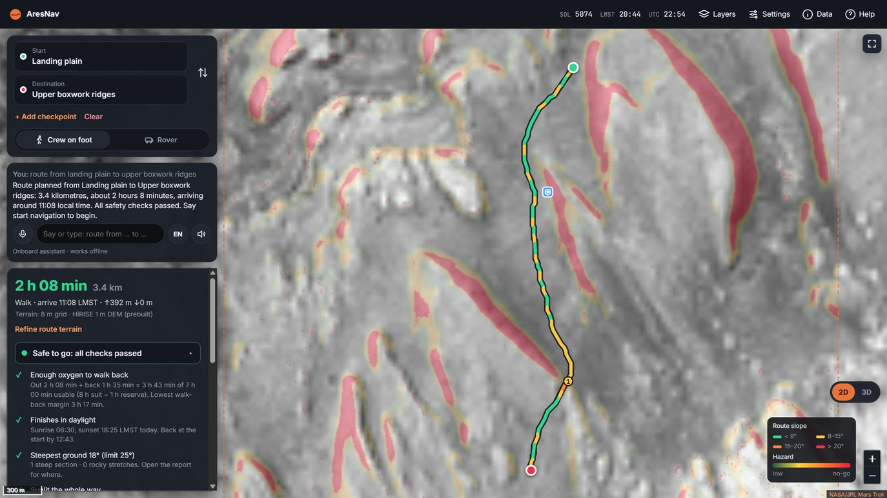

# AresNav: Mars EVA Navigator

**Live demo: [jungwoolee212.github.io/aresnav](https://jungwoolee212.github.io/aresnav/)**. It runs in the browser with nothing to install. An example route is already planned when it opens: press *Start*.



| Turn-by-turn guidance with the voice assistant | 3D view of the analysed terrain |
|---|---|
|  |  |

Screenshots are of the live app (not AI-generated).

**NASA Space Apps Challenge 2026.** A navigation app for crew on foot or in a pressurized rover on Mars. Pick a start and a destination; it plans the safest route and checks it: oxygen to walk back (with effort, carried load and an injured partner taken into account), steep and rocky ground, sunlight, radio line of sight to base, radiation and space weather. It can add Curiosity science sites as timed stops. Then it guides you turn by turn on a map, in a helmet HUD or by voice (English or Korean), and key routes keep working with no network.

It is built around lower Mount Sharp in Gale crater, where a prebuilt HiRISE terrain grid gives EVA-grade results. You can plan anywhere else on Mars too: the app uses the sharpest NASA Mars Trek elevation model for that ground, and routes planned only on coarse global terrain are flagged as a rough guide (small cliffs and rocks don't show at that scale), never "safe to go".

## How to use

1. On first open an **example route** is already planned. Press *Start* to try guidance, or tap the map to set your own start, then tap again for your destination.
2. Read the result: travel time, distance, arrival time (Mars local time) and a safety status. Expand it to see every check.
3. **Report** lists each danger (steep climbs, rocky ground, no-go edges, terrain shadow) with its location on the map, plus the oxygen plan, elevation, sky-view shielding, sunlight, geologic units, science sites near the route, radio line of sight to base, a radiation-dose estimate, dust season and space weather, and the check against Curiosity's real path.
4. **Checkpoints are optional.** Once a route exists, tap the map and choose *Add checkpoint here*, or use *+ Add checkpoint*. Name it, set how long you'll stop, drag it to move it.
5. Switch between **Crew on foot** and **Rover**. Each has its own slope, rock and speed limits (Settings). For crew on foot, Settings also sets suit oxygen and the carried load (tools, samples), which change the oxygen plan.
6. **Start** begins turn-by-turn guidance on a simulated position, played back at the **Sim speed** you pick (10× by default: 10 minutes of walking in 1 minute; 30×, 60× or 240× to skip ahead). **HUD** (next to Start) goes straight into the helmet display with a 3D view of the terrain ahead. Keys: Space pauses, H toggles the HUD, V talks to the voice assistant, Esc goes back.
7. **Compare routes** plans the fastest, balanced and safest options side by side (time, steep ground, distance near no-go ground, average hazard) and draws them dashed on the map. *Use* switches to one.
8. **During guidance**, *Return to start* and *Nearest shelter* re-route from your current position in one tap.
9. **Route sheet** opens a printable summary (save as PDF from the print dialog); **GPX** downloads the track with stops and hazards as waypoints. The ⤢ button on the map zooms back to the whole route.
10. **Science along the way** (Report) lists Curiosity science sites within 3 km of the route. *Add as a science stop* re-plans with the time on site, so the oxygen, daylight and walk-back checks include it.
11. **Offline routes** (Layers): press *Save all for offline* while connected; the four saved routes then plan and guide with no network (see Works offline).
12. **Rover-autonomy sandbox** (Report) downloads the analysed terrain and routes as JSON for path-planning research (see Rover-autonomy sandbox).

## Where you can plan

Anywhere on Mars (88°S–88°N). Once start and destination are set, the app picks the sharpest elevation model NASA Mars Trek has for that ground and analyses a corridor around the route in the browser:

| Ground | Elevation used | What the result means |
|---|---|---|
| Prebuilt box, lower Mount Sharp (orange) | `data/` (HiRISE DEM) | EVA-grade |
| The 10 regional elevation models outlined on the map: Gale, Columbia Hills, Endeavour, Victoria, InSight, West Candor (Valles Marineris), two small HiRISE models and two HRSC areas along *The Martian* path (`js/catalog.js`) | HiRISE ~1–5 m, CTX ~10–20 m or HRSC ~80 m. Metres straight from Trek's elevation services where they exist; for models served only as 8-bit tiles, a metre scale fitted against the global MOLA + HRSC blend | EVA-grade on HiRISE; coarser on CTX/HRSC |
| Everywhere else | Global MOLA + HRSC blend, ~200 m/px | Rough guide only: the general way is right, but cliffs, ledges and rocks smaller than a few hundred metres don't show, so it is flagged in the safety checks and never called "safe to go" on foot |

**Places NASA Trek marks** (`js/places.js`, built by `tools/build_places.py`) are on the map and can be searched, spoken and used as start or destination: Trek's 12 mission bookmarks, 95 mission waypoints (e.g. Bradbury Landing, Vera Rubin Ridge, The Hab), 5 rover / story traverses, and all 1,783 IAU-named features. Click a point → *Start here* / *Make this the destination*, or search under Layers → Go to a site.

Rock density comes from HiRISE image texture where a HiRISE mosaic covers the ground; elsewhere it's marked "not assessed". Where the browser-built grid overlaps the prebuilt one, they agree closely. Built from the same Trek DEM tiles as the prebuilt grid (Gale_DEM_SMG_1m, 8-bit): elevation MAE 3.8 m, slope MAE 0.9°, no-go agreement 98.5%. Built from Trek's full-precision (float) version of the same DEM, which the app uses outside the prebuilt area: slope MAE 3.5°, no-go agreement 93%, with elevations offset by a near-constant ~21 m between the two versions (re-measured 15 Nov 2026).

**Refine.** The terrain line under the route summary shows the grid used. *Refine route terrain* (or Settings → Terrain detail → High) re-analyses the corridor between start and destination on a finer grid (down to 4 m), so long routes get coarser cells only where needed. `tools/build_catalog.py` rebuilds the catalog from Trek.

**2D / 3D.** The 2D/3D switch on the map shows the analysed terrain as a 3D mesh with the route, markers and (during guidance) your position as a small 3D model: a suited astronaut on foot, a pressurized rover when driving, facing the direction of travel. Drag to rotate, scroll to zoom, click the ground to pick a point. Colours show the hazard score (slope and rocks), with a legend: easy ground, some risk, high risk, no-go. If the device renders slowly, it switches to a lighter gray mesh.

## Voice assistant

Tap the mic (or press **V**) and speak, or type in the box.

While planning:

- *"Route from the landing plain to the upper boxwork ridges"*, *"Start from 4.55 south 137.55 east"*, *"Take me to 2 km north west"*, *"Add a checkpoint 300 metres east of landing plain"*, *"Take me to the nearest shelter"*, *"Take me to the highest point"*, *"Switch to rover"*, *"Save the destination as Camp Two"*, *"Start navigation"*
- Places can be a name (built-in or saved), *start*, *destination*, *nearest shelter* (least open sky within 400 m), *highest/lowest point* (in the analysed area), a distance and direction (*"1 km south east of landing plain"*) or coordinates.

During guidance the navigator speaks each turn, steep section, checkpoint and safety alert as you reach it, and you can ask:

- *"How much oxygen do I have?"*, *"What's next?"*, *"How far to go?"*, *"Any danger ahead?"*, *"Where's the nearest shelter?"*, *"Is the sun up?"*, *"Next checkpoint?"*, *"Status"*
- Commands: *pause*, *resume*, *faster*, *slower*, *repeat*, *mute*, *open HUD*, *end navigation*
- Re-routing from where you are: *"Take me to the nearest shelter"*, *"Take me back to base"*, *"Take me to Camp Two"*

Answers come from the live route state onboard, with no network needed (a crew on Mars can't wait 5–20 minutes for Earth, and a dust storm can cut the link entirely; see Works offline). Optionally, paste a Claude API key in **Settings → Voice assistant**: requests the onboard parser doesn't handle then go to Claude (`claude-opus-5-5`) with a snapshot of the app, and Claude can plan routes through a `set_route` tool that uses the same place resolver. Commands still run onboard. The key is kept only in that browser's localStorage and is sent only to the Anthropic API. If Claude can't be reached, the onboard answer is used.

**Korean (한국어).** Tap **EN/한** in the voice panel (or Settings → Voice language). Recognition switches to ko-KR, and replies and turn-by-turn prompts are spoken in Korean: *"착륙 평원에서 박스워크 능선까지 안내해 줘"*, *"가장 가까운 대피소로 데려가 줘"*, *"북서쪽으로 2킬로미터 가 줘"*, *"남위 4.55 동경 137.55에서 출발"*, *"산소 얼마나 남았어?"*, *"다음은 어디로 가?"*, *"일시정지"*, *"기지로 돌아가"*. `js/voice-ko.js` maps Korean phrasing onto the same commands and translates the assistant's sentences.

Speech output uses the browser's speech synthesis. Voice input uses the Web Speech API (Chrome, Edge, Safari); in other browsers, type the question.

## What it assesses

| Check | How |
|---|---|
| Route | A* over an 8 m grid. It minimises travel time plus a penalty near steep or rocky ground and never crosses no-go cells. |
| Slope & elevation | HiRISE Gale DEM (Mars Trek), slope over a ~70 m baseline |
| Rocks & ridges | Texture energy of the HiRISE mosaic |
| Oxygen / walk-back | Oxygen used so far + oxygen to walk back vs. suit duration minus reserve, at every point. Use scales with effort (Pandolf et al. 1977 load-carriage equation: grade, pace, carried load, rocky ground) relative to walking on the flat. A planning estimate, shown along the route in the report's Oxygen plan. |
| Two-person EVA | If one crew member is hurt, the pair walks back at 60% pace: the oxygen must still cover that from every point. Also the time a pressurized rover from base needs to reach the farthest point. |
| Daylight & shadow | Sun position (Mars24 algorithm) vs. the terrain horizon at the time you pass each point |
| Radiation shielding (relative) | Share of the sky not blocked by terrain (sky-view factor from the DEM), plus the most sheltered spot near the route. A relative measure, not a dose: no dose data is used. |
| Radiation dose (estimate) | Curiosity RAD's ~640 µSv/day at Gale (Hassler et al. 2014) × time outside × the route's average open sky. Rough, first-order. |
| Radio line of sight | From a 5 m base antenna at the start to a 2 m suit antenna, over the terrain and the planet's curvature. Radio-shadow stretches are shown and announced; guidance keeps working offline there. |
| Space weather & dust | Solar storms (CMEs) predicted to reach Mars from NASA DONKI's WSA-ENLIL runs (cached, kept offline). Dust-storm season from the Mars season, Ls 180°–330° (climatology: no public Mars dust forecast exists). |
| Science along the way | Curiosity science sites within 3 km of the route (Trek waypoints), tagged by objective, added as timed science stops in one tap. |
| Geologic context | Units crossed by the route, from the USGS global geologic map (SIM 3292) via Trek. Regional setting only, not used for routing. |

## Checked against Curiosity's real path

The report can plan any of 12 stretches of Curiosity's drive between named waypoints (Bradbury Landing to Hematite Hotspot), in rover mode on Trek's HiRISE terrain, and compare the result with the path Curiosity's drivers actually took (Trek's traverse line, a vertex every ~106 m).

Results on 14 Nov 2026, all 12 stretches planned as safe:

| Stretch | Within 50 m of Curiosity's path | Median gap |
|---|---|---|
| Bradbury Landing → The Rocknest | 100% | 13 m |
| Glenelg → Darwin Outcrop | 57% | 28 m |
| Darwin Outcrop → The Kimberly | 35% | 87 m |
| The Kimberly → Pahrump Hills | 26% | 81 m |
| Pahrump Hills → Marias Pass | 63% | 36 m |
| Marias Pass → Bagnold Dunes | 90% | 35 m |
| Bagnold Dunes → Bagnold Dunes West End | 76% | 11 m |
| Bagnold Dunes West End → Murray Buttes | 94% | 6 m |
| Murray Buttes → Bagnold Dunes South | 30% | 82 m |
| Bagnold Dunes South → Vera Rubin Ridge | 42% | 77 m |
| Vera Rubin Ridge → Top of Vera Rubin Ridge | 100% | 10 m |
| Top of Vera Rubin Ridge → Hematite Hotspot | 78% | 31 m |

On average the planned route stays within 50 m of Curiosity's path for 66% of its length; the median of the median gaps is 33 m. The planner's routes are usually shorter: Curiosity's drivers also detoured to science targets and used sub-metre images, so a perfect match isn't expected. Gaps under ~30 m are within the precision of the traverse line.

## Data (NASA Mars Trek, USGS, Curiosity RAD and NASA DONKI)

- MRO HiRISE mosaic of Curiosity's roving site and the HiRISE Gale crater DEM: processed into `data/` by `tools/build_site_data.py`.
- Map layers: HiRISE, CTX, Viking (MDIM 2.1, made by USGS Astrogeology), MOLA, THEMIS day/night IR, TES thermal inertia, clay/glass and plagioclase.
- USGS global geologic map of Mars (Tanaka et al. 2014, SIM 3292), served by Trek: a map layer, and the report names the units a route crosses. At 1:20,000,000 it's regional context, not used for routing.
- Curiosity's traverse and waypoints (Trek): used to check the planner, see above.
- Site context: NASA's *Curiosity's proposed path up Mount Sharp*.
- Curiosity RAD's measured surface dose rate at Gale, ~640 µSv/day (Hassler et al. 2014): the base of the radiation-dose estimate.
- NASA DONKI (Space Weather Database Of Notifications, Knowledge, Information), via api.nasa.gov: WSA-ENLIL model runs that predict solar storms (CMEs) reaching Mars. Fetched at most every 3 hours and kept for offline use.

**Elevation scale.** Trek serves the DEM as 8-bit tiles. Heights use `metres = 17.97 × DN − 4569.2`, fitted once against Curiosity's published elevations (RMS 4.6 m). This is disclosed in the app's Data panel. Slopes, shadows and shielding don't depend on it.

## Run locally

No install or build step. Serve the folder over HTTP (ES modules and the service worker don't run from `file://`) and open it in Chrome, Edge or Safari:

```bash
python3 -m http.server 8000
# then open http://localhost:8000/
```

No keys or environment variables are needed. Live space weather uses NASA's public `DEMO_KEY`; the optional Claude fallback only runs if a user pastes their own key in Settings.

## Rebuild the terrain data

```bash
python3 tools/build_site_data.py
```

Needs `numpy` and `Pillow`. Downloads about 460 Trek tiles (about 6 minutes).

## Deploy (GitHub Pages)

Push to a public GitHub repo. Then go to **Settings → Pages → Deploy from a branch → `main` / root**. There is no build step.

## Use of AI (SI) tools

- **Code.** The code, data-processing scripts and this README were written with an AI coding assistant, Claude Code (Anthropic's Claude models), under the team's direction. The team chose the design, set the requirements and data sources, and tested and reviewed the results.
- **Data.** No data in this app is AI-generated. Terrain, elevation, imagery and place names come from NASA Mars Trek. AI-written scripts in `tools/` process that data into `data/`, `js/catalog.js` and `js/places.js`.
- **In the app.** The voice assistant runs onboard without AI by default. If a user pastes their own Claude API key in Settings, questions the onboard parser can't handle go to Claude (`claude-opus-5-5`). This is optional and off by default.
- **Images and video.** None of the images in the app are AI-generated. No NASA logos, flags or mission insignia are used.

## References

Every outside source the app uses, where it's used, and its licence or credit line.

**NASA data**

| Source | Used for | Terms |
|---|---|---|
| [NASA Mars Trek](https://trek.nasa.gov/mars/) (NASA/JPL-Caltech): map tiles, elevation services, layer catalogue, bookmarks, waypoints and traverses | Base map and layers, terrain analysis anywhere on Mars (`js/terrain-live.js`), prebuilt site (`tools/build_site_data.py` → `data/`), regional model catalogue (`tools/build_catalog.py` → `js/catalog.js`), named places (`tools/build_places.py` → `js/places.js`) | NASA data, used under [NASA's media usage guidelines](https://www.nasa.gov/nasa-brand-center/images-and-media/) |
| MRO HiRISE images and DEMs, via Trek (NASA/JPL/University of Arizona) | Prebuilt Gale site, EVA-grade slopes, rock-texture estimate | Public domain; credit requested: NASA/JPL/University of Arizona |
| MRO CTX mosaics and DEMs, via Trek (NASA/JPL/MSSS) | Regional terrain models, map layer | Credit: NASA/JPL/MSSS |
| MGS MOLA + Mars Express HRSC blended global DEM, via Trek (NASA/JPL/GSFC, ESA/DLR/FU Berlin) | Terrain everywhere outside regional models (~200 m, rough guide only) | Credit: NASA/JPL/GSFC; HRSC: ESA/DLR/FU Berlin, CC BY-SA 3.0 IGO (attribution, share-alike for derived data) |
| Viking, THEMIS day/night IR, TES thermal inertia, clay/glass and plagioclase layers, via Trek | Optional map layers | Credit as listed in Trek's layer metadata |
| [USGS global geologic map of Mars](https://pubs.usgs.gov/publication/sim3292) (Tanaka et al. 2014, SIM 3292), via Trek's map service | Geologic map layer; geologic units named in the route report | USGS public domain; credit: USGS |
| Curiosity traverse line and waypoints, via Trek | Checking planned routes against Curiosity's real path (`js/extras.js`); science stops (`js/science.js`); sandbox expert path (`js/sandbox.js`) | NASA data |
| [NASA DONKI](https://ccmc.gsfc.nasa.gov/tools/DONKI/) WSA-ENLIL simulations, via [api.nasa.gov](https://api.nasa.gov/) | Solar storms predicted to reach Mars (`js/conditions.js`) | NASA open API (public `DEMO_KEY`) |
| IAU planetary feature names (IAU WGPSN), via Trek's search index | Searchable and spoken place names | Public nomenclature |
| [Curiosity's proposed path up Mount Sharp](https://science.nasa.gov/resource/curiositys-proposed-path-up-mount-sharp/) (NASA/JPL-Caltech/Univ. of Arizona) | Site context in the Data panel | NASA image, credited |

**Published methods**

| Source | Used for |
|---|---|
| Hassler, D. M. et al. (2014), Mars' surface radiation environment measured with the Mars Science Laboratory's Curiosity rover, *Science* 343, 1244797 | Surface dose rate for the radiation-dose estimate |
| Pandolf, K. B., Givoni, B. & Goldman, R. F. (1977), Predicting energy expenditure with loads while standing or walking very slowly, *J. Appl. Physiol.* 43, 577–581 | Effort model behind the oxygen plan |
| Allison, M. & McEwen, M. (2000), A post-Pathfinder evaluation of areocentric solar coordinates, *Planet. Space Sci.* 48, 215–235 (the algorithm of NASA GISS Mars24) | Sun position and Mars local time (`js/sun.js`) |

**Software and fonts**

| Source | Used for | Licence |
|---|---|---|
| [Leaflet 1.9.4](https://leafletjs.com/) (cdnjs) | 2D map | BSD-2-Clause |
| [three.js 0.160](https://threejs.org/) and OrbitControls (jsDelivr) | 3D terrain view and helmet display | MIT |
| [Anthropic TypeScript SDK](https://github.com/anthropics/anthropic-sdk-typescript) (jsDelivr) | Optional: only loaded if a user adds their own Claude API key | MIT |
| [Inter](https://rsms.me/inter/) and [JetBrains Mono](https://www.jetbrains.com/lp/mono/) (Google Fonts) | Interface text | SIL Open Font License 1.1 |
| Web Speech API ([W3C spec](https://webaudio.github.io/web-speech-api/)): speechSynthesis and SpeechRecognition, built into the browser | Voice output and input | Browser feature, no extra code |
| Python [NumPy](https://numpy.org/) and [Pillow](https://python-pillow.org/) | Offline data-building scripts in `tools/` | BSD-3-Clause; MIT-CMU (HPND) |

**Reviewed, not used:** the Mars 2020 raw-image feed (the app draws a synthetic 3D terrain view instead). The USGS geologic map is used for context only, not for routing: at 1:20,000,000 the whole Mount Sharp planning area falls in two of its units.

## Rover-autonomy sandbox

The route report's **Rover-autonomy sandbox** button exports the analysed real Mars terrain as one JSON file: elevation, slope, rock-density and no-go grids, the rover limits, the route AresNav planned (a baseline) and, where it crosses that ground, the path Curiosity's drivers actually took (an expert demonstration). It turns any place on Mars the app can analyse into a planning-level environment for path-planning or reinforcement-learning agents:

```python
import json, base64, numpy as np
d = json.load(open("aresnav-sandbox-....json")); g = d["grid"]
grid = {k: np.frombuffer(base64.b64decode(v["data"]), v["dtype"]).reshape(g["ny"], g["nx"]) for k, v in d["layers"].items()}
```

Cells are metres across, so it is for route choice, not camera-based hazard avoidance or wheel-soil physics. Inside the app, rover mode already plans within the rover's slope and rock limits and drives the route in simulation.

## Works offline

On Mars a crew can't count on a network link. A dust storm, terrain blocking the line of sight to the habitat or a relay orbiter, or simply walking far from base can cut the connection at any moment. So AresNav keeps working without one:

- The app, its libraries and fonts, and the prebuilt Gale terrain are saved on the device the first time it opens (a service worker, `sw.js`).
- Every NASA Mars Trek map tile and elevation tile the app loads is kept too. Once a route has been planned with a connection, planning it again, guidance, the safety checks, the 3D view, the helmet display and the voice assistant's understanding all work with no network.
- **Offline routes** (Layers → Offline routes): four key traverses at real rover sites, all on sharp elevation models. Press *Save all for offline* while connected; afterwards they open, plan and guide with no network:
  - Gale: Landing plain → Upper boxwork ridges
  - Gale: Pahrump Hills → Murray Buttes (Curiosity)
  - Gusev: Columbia Memorial Station → Home Plate (Spirit)
  - Endeavour: Matijevic Hill → Marathon Valley (Opportunity)
- Places that were never loaded still need a connection, and the app says so instead of failing silently.

Tested by planning online, then shutting the web server down and blocking every network request: all four saved routes planned and guided, and the voice assistant answered in English and Korean. Typed questions work fully offline; spoken input depends on the browser (Chrome sends speech to an online recogniser).

## Limits

Planning aid for a concept study. Features smaller than a few metres aren't in the slope grid. Position during navigation is simulated. Walking speed, suit duration, carried load and rover limits are adjustable assumptions. Oxygen use and radiation dose are planning estimates, not sensor readings. The radio check covers a direct line to a base antenna only (no relay orbiters), and dust season is climatology, not a forecast.

## License

The code is released under the [MIT License](LICENSE). NASA data (in `data/` and fetched from Mars Trek) stays under NASA's terms, and third-party libraries and fonts keep their own licences (see References).
